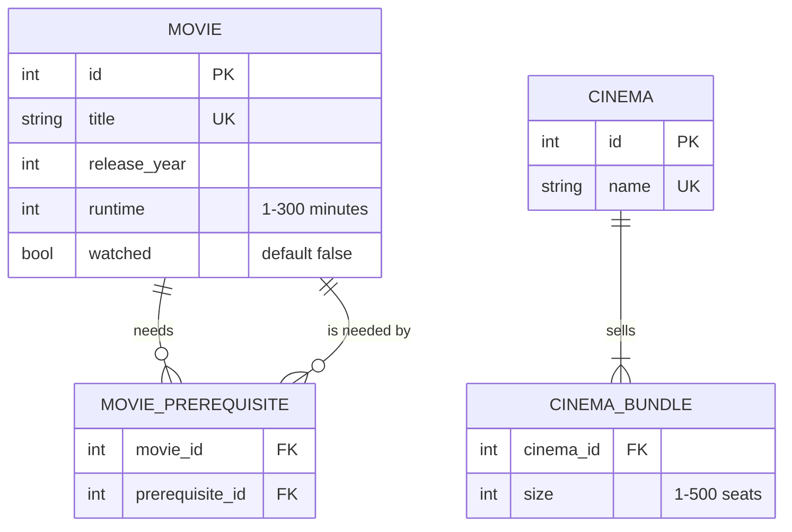

# Doomsday Ready

Plan your MCU rewatch before *Avengers: Doomsday*, then book the whole crew into an opening-night watch party.

- **Rewatch order:** pick a target movie and get every movie you need first, in a valid order, with progress and remaining watch time.
- **Booking quote:** pick a cinema and a group size and get the fewest seat bundles that add up to exactly that many seats, or "not possible".
- **Modern Experience:** live interactive auditorium seating layout, DAG prerequisite flow graph, Avengers: Doomsday premiere countdown, and official trailer links.
- **Stack:** Node.js, Express 5, SQLite (better-sqlite3), Zod, React 19 (Vite), Vitest, Docker Compose.

## Run it

### With Docker (one command)

```bash
docker compose up --build
```

- App: http://localhost:8080
- API: http://localhost:4000/api

Sample data (8 movies, 4 cinemas) is loaded on first start. Data persists in a Docker volume.

### Without Docker

Requires Node.js 20 or newer. Use two terminals.

```bash
# Terminal 1: API on http://localhost:4000
cd backend
npm install
npm start

# Terminal 2: UI on http://localhost:5173
cd frontend
npm install
npm run dev
```

### Tests

```bash
cd backend
npm test
```

Covers the algorithm examples from the brief (booking and rewatch order), cycle detection, edge cases and the HTTP API.

## API (under `/api`)

| Method and path | Purpose |
|---|---|
| `POST /movies` | Create a movie |
| `GET /movies` | List movies (with prerequisite ids) |
| `PATCH /movies/:id` | Update a movie, including `watched` and `prerequisites` |
| `DELETE /movies/:id` | Delete a movie (extra) |
| `GET /movies/:id/rewatch-order` | Rewatch order (feature 1) |
| `POST /cinemas` | Create a cinema |
| `GET /cinemas` | List cinemas |
| `GET /cinemas/:id/booking?groupSize=6` | Booking quote (feature 2) |

Errors share one shape: `{ "error": "CODE", "message": "...", "details": [...] }`.
Codes: `VALIDATION_ERROR` (400), `NOT_FOUND` (404), `DUPLICATE_TITLE` / `DUPLICATE_NAME` / `CIRCULAR_DEPENDENCY` (409).

## Data model



Prerequisites are a many-to-many join table, so a movie can have several prerequisites and be a prerequisite of several movies. A database check stops a movie linking to itself.

## How the algorithms work

Both live in `backend/src/logic/` as pure functions (no database), written without any solver libraries.

**Rewatch order** (`rewatch.js`): movies are a graph where each movie points to its prerequisites. A depth-first search from the target records each movie only after all its prerequisites (post-order), which is a topological sort of the target's ancestors. A visited set makes each movie appear once. Time O(V + E).

**Cycle detection** (`wouldCreateCycle`): before saving new prerequisites for movie M, search from each new prerequisite along its own prerequisites. If M is reached (or a prerequisite is M itself), saving would create a loop, so the API answers `409 CIRCULAR_DEPENDENCY`.

**Booking quote** (`booking.js`): minimum coin change by dynamic programming. `fewest[i]` is the fewest bundles for exactly `i` seats; `fewest[i] = min(fewest[i - b] + 1)` over bundle sizes `b`. A second array remembers the last bundle used so the answer can be rebuilt. Greedy fails: for bundles 6, 9, 20 and 44 seats it takes 20 + 20 and gets stuck, while the true answer is 20 + 9 + 9 + 6. Time O(groupSize x bundles).

## Assumptions

- **Booking ties:** when several combinations use the same number of bundles, bundle sizes are tried largest first, so larger bundles win ties.
- **Duplicate bundle sizes** in one cinema are rejected, since the brief says a cinema has 1 to 10 *different* sizes.
- **Titles and cinema names** are unique, ignoring upper/lower case.
- **Rewatch order:** several valid orders can exist. Prerequisites are explored in id order, so the result is deterministic. Watched movies stay in the list (shown ticked); only the remaining runtime ignores them.
- **Runtime and year:** runtime is 1 to 300 minutes; release year is 1888 to 2100.
- **Creating a movie** cannot form a cycle (nothing can depend on a movie that does not exist yet), so cycles can only come from `PATCH`; the same check covers self-links.
- **Deleting a movie** also removes it from other movies' prerequisites (cascade).
- **Doomsday runtime:** the sample runtime (150 min) is a placeholder, since the film is unreleased.

## How I used AI

> Edit this section so it is true to what you actually did before you submit.

I used Claude (Anthropic) to plan the project, to explain the graph and dynamic-programming approaches step by step, and to help generate the API, React UI, Docker setup and this README. I read through the code, ran the tests, and can explain every part of it, especially cycle detection and the booking DP.